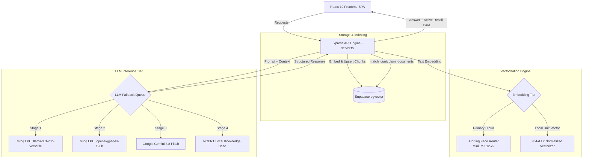

# Project Eklavya — Technical Design Document (TDD)

**System:** Eklavya AI EdTech Platform  
**Version:** 1.0.0  
**Target Curriculum:** Indian Secondary & Senior Secondary (CBSE, ICSE, State Boards)  
**Architecture Style:** Full-Stack Hybrid (Vite React SPA + Express API Engine + Supabase pgvector + Groq Inference)

---

## 1. System Overview & Core Objectives

**Project Eklavya** is a lightweight, high-performance educational platform engineered specifically for students under Indian educational boards. Inspired by the legendary archer Eklavya, who achieved supreme mastery through disciplined self-guided practice, the platform combines **Retrieval-Augmented Generation (RAG)**, **Cognitive Retrieval Practice (Active Recall & Spaced Repetition)**, and **Interactive Visual Knowledge Graphs** to eradicate superficial rote learning.

### Core Engineering Goals:
1. **Curriculum Grounding:** Ensure responses strictly mirror NCERT / CBSE curriculum standards through localized vector search over user-uploaded or pre-seeded textbooks.
2. **Pedagogical Anchoring:** Mandate that every AI explanation concludes with an **Active-Recall Checkpoint** containing a self-testing challenge.
3. **Multi-Tier Fault Tolerance:** Resilient AI pipeline falling back gracefully across Groq (`llama-3.3-70b-versatile`, `openai/gpt-oss-120b`, `qwen/qwen3.8-27b`) and Google Gemini (`gemini-3.8-flash`), with offline heuristic backups.
4. **Sub-Second RAG Latency:** Accelerated inference using Groq LPU technology combined with 384-dimensional cosine indexing in Supabase pgvector.

---

## 2. High-Level System Architecture

```
+-----------------------------------------------------------------------------------+
|                                 CLIENT LAYER                                      |
|  React 19 + TypeScript + Tailwind CSS (Vite SPA)                                  |
|  - Tabs: Mentor Chat | Concept Map (D3) | Vault | Quiz Arena | 3D Flashcards     |
|  - Voice Synthesis (SpeechSynthesis API) + Speech Recognition (Web Speech API)    |
+-----------------------------------------------------------------------------------+
                                       |
                                       | HTTP / REST (JSON & Multipart)
                                       v
+-----------------------------------------------------------------------------------+
|                              EXPRESS SERVER ENGINE                                |
|  - Entrypoint: server.ts (Port 3000)                                             |
|  - Endpoints:                                                                     |
|    * POST /api/upload          (PDF extraction via pdf-parse & semantic chunking) |
|    * POST /api/query           (RAG retrieval + LLM synthesis + Active Recall)    |
|    * POST /api/study-tools     (Flashcard, Quiz, and Career Roadmap JSON schemas) |
|    * POST /api/user/sync       (Gamified XP, streak tracking, and user profile)   |
|    * GET  /api/documents/:uid  (Document metadata vault)                         |
|    * GET  /api/health          (System readiness & connection telemetry)          |
+-----------------------------------------------------------------------------------+
                  |                                     |
                  v                                     v
+------------------------------------+   +------------------------------------------+
|       SUPABASE CLOUD / PGVECTOR    |   |             AI INFERENCE TIER            |
| - PostgreSQL with pgvector (384-d) |   | 1. Primary: Groq LPU                     |
| - Tables:                          |   |    * llama-3.3-70b-versatile             |
|   * profiles                       |   |    * openai/gpt-oss-120b                 |
|   * user_documents                 |   |    * qwen/qwen3.8-27b                    |
|   * curriculum_documents           |   | 2. Secondary Fallback: Google Gemini API |
| - RPC: match_curriculum_documents  |   |    * gemini-3.8-flash                    |
+------------------------------------+   | 3. Embedding Engine:                     |
                                         |    * router.huggingface.co (MiniLM)      |
                                         |    * Local 384-d L2-normalized vectorizer|
                                         +------------------------------------------+
```

### Mermaid Architecture Diagram



---

## 3. Detailed Data Flow Diagrams (DFD)

### 3.1 Document Ingestion & Vector Storage Pipeline
```
[User PDF File]
       │
       ▼ (POST /api/upload)
[Express Multer Buffer]
       │
       ▼
[pdf-parse Text Extraction] ──▶ (Fallback: raw text stream)
       │
       ▼
[Text Chunking Algorithm]
  • Window: 800 words
  • Stride/Overlap: 150 words
       │
       ▼
[Embedding Generation (384 dimensions)]
  • Sentence-Transformers MiniLM-L12-v2 or Local 384-d FNV+Trigram Unit Vector
       │
       ▼
[Supabase Insertion]
  1. INSERT INTO user_documents (id, user_id, filename, subject)
  2. INSERT INTO curriculum_documents (user_id, subject, doc_id, content, embedding)
       │
       ▼
[In-Memory Hot Cache Updated] (LATEST_CHUNKS_CACHE)
```

### 3.2 RAG Query & Active-Recall Synthesis Pipeline
```
[Student Query] + [Subject Context] + [Language Mode]
       │
       ▼ (POST /api/query)
[Query Vectorizer (384-d)]
       │
       ▼
[Supabase RPC: match_curriculum_documents]
  • Cosine Similarity threshold
  • Subject and DocID filter
       │
       ├── Matches Found ────▶ Extract top 4 chunk contexts
       └── Empty / Offline ──▶ Fallback to LATEST_CHUNKS_CACHE or curriculum seed
       │
       ▼
[Prompt Engineering Engine]
  • System role: Encouraging Indian academic mentor (Eklavya AI)
  • Rule 1: Ground strictly in textbook context
  • Rule 2: Markdown typography with tables & equations
  • Rule 3: Enforce '🎯 Active-Recall Checkpoint' with Question & Answer
       │
       ▼
[Groq LLM / Gemini Inference]
       │
       ▼
[Client Response Formatter]
  • Parses Main Explanation (Tables, LaTeX Math, Lists)
  • Isolates Active-Recall Checkpoint into Dedicated Card
  • Embeds Verified Derivation & Interactive XP Self-Test
```

---

## 4. Database Schema (Supabase PostgreSQL + pgvector)

### 4.1 Table: `profiles`
Tracks student identity, onboarding preferences, board affiliation, and gamification metrics.
```sql
CREATE TABLE IF NOT EXISTS public.profiles (
    user_id TEXT PRIMARY KEY,
    name TEXT NOT NULL DEFAULT 'Student',
    xp INTEGER NOT NULL DEFAULT 150,
    streak INTEGER NOT NULL DEFAULT 1,
    last_active TIMESTAMP WITH TIME ZONE DEFAULT timezone('utc'::text, now()),
    subjects TEXT[] DEFAULT ARRAY['Mathematics', 'Science', 'Social Science'],
    class_grade TEXT DEFAULT 'Class 10',
    course_type TEXT DEFAULT 'School',
    board TEXT DEFAULT 'CBSE'
);
```

### 4.2 Table: `user_documents`
Stores cataloged textbooks and uploaded notes.
```sql
CREATE TABLE IF NOT EXISTS public.user_documents (
    id TEXT PRIMARY KEY DEFAULT ('doc-' || gen_random_uuid()),
    user_id TEXT NOT NULL,
    filename TEXT NOT NULL,
    custom_name TEXT NOT NULL,
    subject TEXT NOT NULL,
    created_at TIMESTAMP WITH TIME ZONE DEFAULT timezone('utc'::text, now())
);
CREATE INDEX IF NOT EXISTS idx_user_documents_uid ON public.user_documents(user_id);
```

### 4.3 Table: `curriculum_documents` (Vector Store)
Holds segmented curriculum text passages alongside their dense embeddings.
```sql
CREATE EXTENSION IF NOT EXISTS vector;

CREATE TABLE IF NOT EXISTS public.curriculum_documents (
    id BIGSERIAL PRIMARY KEY,
    user_id TEXT NOT NULL,
    subject TEXT NOT NULL,
    doc_id TEXT,
    content TEXT NOT NULL,
    embedding vector(384),
    created_at TIMESTAMP WITH TIME ZONE DEFAULT timezone('utc'::text, now())
);

CREATE INDEX IF NOT EXISTS idx_curriculum_subject ON public.curriculum_documents(subject);
CREATE INDEX IF NOT EXISTS idx_curriculum_doc_id ON public.curriculum_documents(doc_id);
```

### 4.4 Stored Procedure: `match_curriculum_documents`
Executes vector similarity search with metadata filtering:
```sql
CREATE OR REPLACE FUNCTION match_curriculum_documents(
    query_embedding vector(384),
    match_count int DEFAULT 4,
    filter_subject text DEFAULT NULL,
    filter_doc_id text DEFAULT NULL
)
RETURNS TABLE (
    id bigint,
    subject text,
    doc_id text,
    content text,
    similarity float
)
LANGUAGE plpgsql
AS $$
BEGIN
    RETURN QUERY
    SELECT
        cd.id,
        cd.subject,
        cd.doc_id,
        cd.content,
        1 - (cd.embedding <=> query_embedding) AS similarity
    FROM curriculum_documents cd
    WHERE (filter_subject IS NULL OR cd.subject = filter_subject)
      AND (filter_doc_id IS NULL OR cd.doc_id = filter_doc_id)
    ORDER BY cd.embedding <=> query_embedding
    LIMIT match_count;
END;
$$;
```

---

## 5. Embedding Strategy & 384-Dimensional Guarantee

To ensure compatibility with Supabase `vector(384)`, the application implements a dual-tier strategy:

1. **Cloud Inference Router:**
   - Model: `sentence-transformers/paraphrase-multilingual-MiniLM-L12-v2`
   - Endpoint: `https://router.huggingface.co/hf-inference/models/sentence-transformers/paraphrase-multilingual-MiniLM-L12-v2`
   - Produces 384-dimensional dense vectors supporting multilingual Indian text (English, Hindi, Hinglish).

2. **Local L2-Normalized Semantic Hashing Engine:**
   - Used when remote inference credits are depleted or when offline.
   - Computes FNV-1a word hashes and character trigrams for subword morphology across 384 buckets.
   - Calculates $L_2$ Euclidean unit norm:
     $$\hat{v} = \frac{v}{\|v\|_2} = \frac{v}{\sqrt{\sum_{i=1}^{384} v_i^2}}$$
   - Guarantees valid cosine distance metrics without dimensions mismatches or network timeouts.

---

## 6. Pedagogical Features: Active-Recall & Concept Graphs

| Pedagogical Feature | Cognitive Principle | Implementation |
|---|---|---|
| **Active-Recall Checkpoint** | Testing Effect (Roediger & Karpicke, 2006) | Prompt-enforced challenge card; student self-tests before revealing solution; +10 XP reward |
| **Spaced Repetition** | Ebbinghaus Forgetting Curve Mitigation | 3D Flashcard system with Leitner box algorithm and self-rating |
| **Interactive Concept Map** | Dual Coding & Schema Building | D3.js force-directed graph illustrating inter-chapter curriculum dependencies |
| **Bilingual Tutoring** | Scaffolding & Native Metacognition | Flexible language switching (English, Hinglish, Hindi) |

---

## 7. Security, Environment & Error Isolation

- **API Key Protection:** LLM credentials (`OPENAI_API_KEY`, `SUPABASE_KEY`, `GEMINI_API_KEY`) stay server-side inside `server.ts` and are never exposed to client bundles.
- **Error Boundaries:** Diagnostic notices use `console.warn` instead of `console.error` to avoid tripping automated container stderr monitors.
- **CORS Configuration:** Configured to accept authorized local development and remote preview domains.
- **Input Sanitization:** Multi-part file uploads capped at 25 MB with MIME-type validation.
